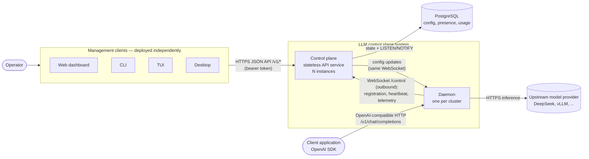

# L0 — System context

## Purpose

The LLM control plane centrally manages model configuration for a fleet of
lightweight inference gateways ("daemons") deployed across multiple clusters
and networks. It is intended as a drop-in replacement for per-cluster LiteLLM
deployments.

Two properties shape the whole design:

1. **Inference traffic never passes through the control plane.** Applications
   call a daemon in their own cluster, and the daemon calls the upstream model
   provider directly. The control plane only distributes configuration and
   collects telemetry.
2. **Daemons dial out.** Each daemon opens a persistent WebSocket to the control
   plane. The control plane never connects to a daemon, so daemons can run
   behind NAT and firewalls in different regions (for example Hangzhou and
   Singapore) as long as they can reach the control plane.

## Context diagram

Target architecture per [ADR 0001](./adr/0001-api-only-stateless-control-plane.md).
The proof of concept already runs the control plane as an API-only service with
separately deployed clients, but still keeps state in memory in a single
instance; see [L1 — current vs. target](./L1-system-design.md#current-vs-target).

## Actors and external systems

| Actor / system | Interaction |
| --- | --- |
| Operator | Uses any management client (web, CLI, TUI, desktop) to inspect daemons and usage and to push model configuration. |
| Management clients | Separately deployed programs that call the control-plane JSON API. None is privileged; all use types from `contract/openapi.yaml`. |
| PostgreSQL | Durable store for desired config, daemon presence, and usage; also carries cross-instance change notifications (`LISTEN`/`NOTIFY`). |
| Client application | Any OpenAI-compatible client. Talks only to the daemon in its cluster. |
| Upstream model provider | OpenAI-shaped chat completion API. Called by daemons, never by the control plane. |

## System responsibilities

| Responsibility | Owner |
| --- | --- |
| Desired model configuration (single source of truth) | Control plane API, persisted in PostgreSQL |
| Fleet visibility: connected daemons, load, token usage | Control plane API, persisted in PostgreSQL |
| Operator UI / tooling | Independent clients (web, CLI, TUI, desktop) |
| Serving OpenAI-compatible inference to clients | Daemon |
| Upstream credentials, routing, and timeouts | Daemon (credentials can stay on the daemon host via `api_key_env`) |
| Per-request usage accounting | Daemon, reported to the control plane |

## Key technical decisions

| Decision | Rationale |
| --- | --- |
| Rust for both services | Small static binaries, predictable latency, one language for shared types. |
| WebSocket + JSON control channel instead of gRPC | Traverses HTTP proxies and restrictive firewalls between regions; easy to debug. |
| Contract-first JSON API (`contract/openapi.yaml`) | Rust DTOs and TypeScript types are generated from one file; tests catch drift. |
| Control plane is API-only; clients are separate deployables | Supports web, CLI, TUI, and desktop clients equally; clients release independently. ([ADR 0001](./adr/0001-api-only-stateless-control-plane.md)) |
| Stateless control-plane processes; PostgreSQL holds state and fans out changes with `LISTEN`/`NOTIFY` | Survives restarts, scales horizontally, no extra infrastructure. ([ADR 0001](./adr/0001-api-only-stateless-control-plane.md)) |
| Standalone daemon | Built and shipped independently; configured only by CLI flags and its own TOML file. |

## Scope of the current proof of concept

In scope: configuration distribution, daemon registration and heartbeats,
OpenAI-compatible chat completions (unary and streaming), provider-reported
token accounting, and a status dashboard.

Implemented from the ADR: API-only control plane with a versioned `/v1` API.
Accepted but not yet implemented: API authentication (declared in the contract
only), PostgreSQL persistence, and multiple control-plane instances
([ADR 0001](./adr/0001-api-only-stateless-control-plane.md)).

Out of scope: virtual keys and spend limits. See
[Known gaps](./L1-system-design.md#known-gaps).
