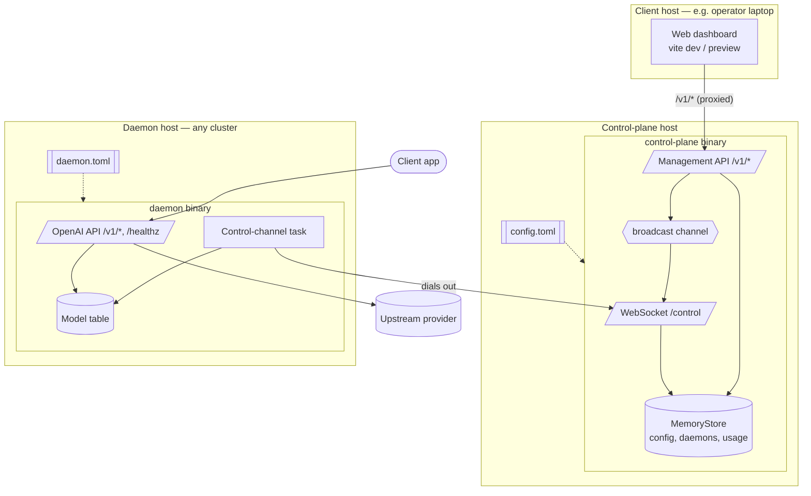
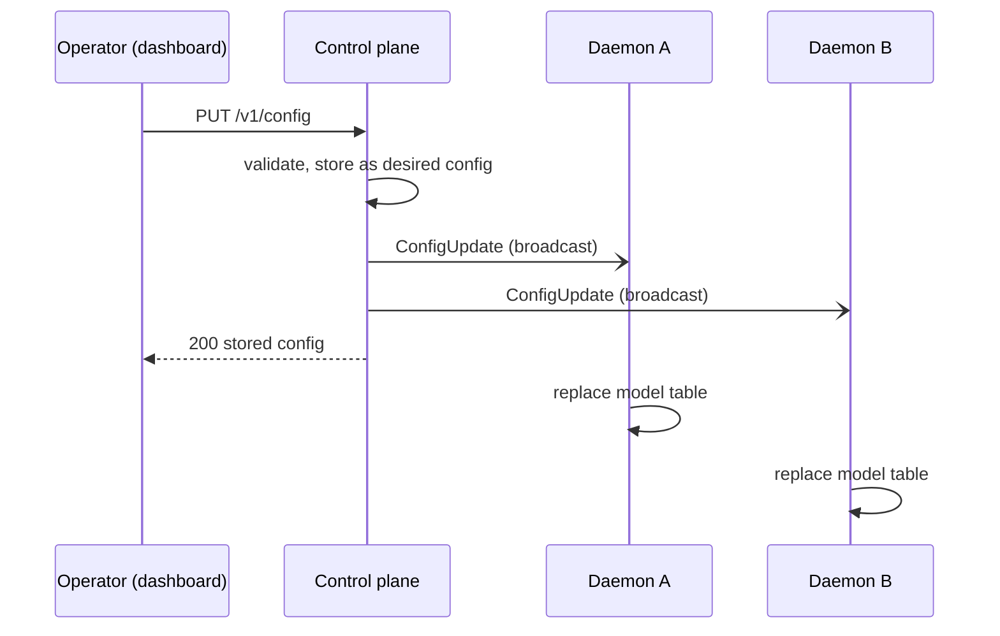
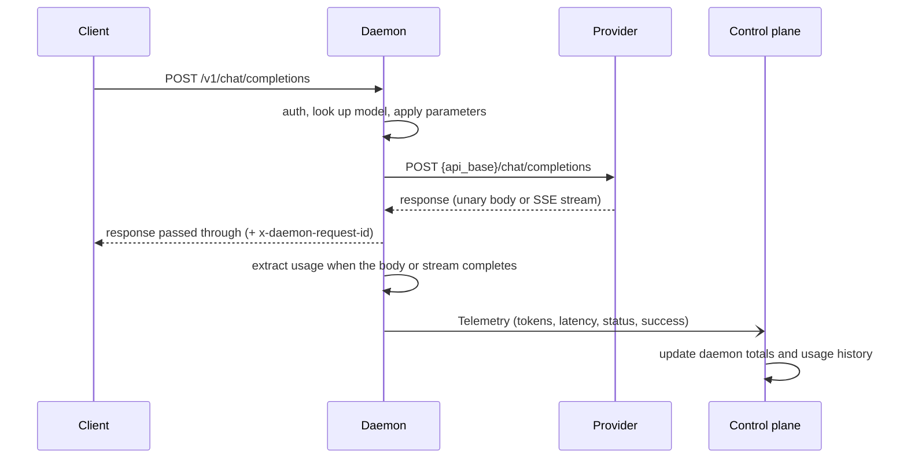
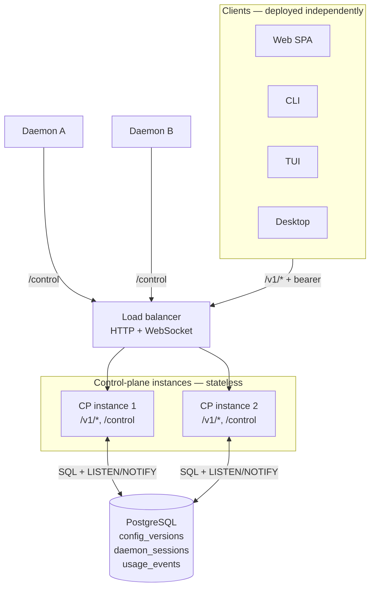

# L1 — Containers and flows

This level breaks the system into deployable units, the interfaces between
them, and the main runtime flows.

The diagrams and PoC limitations below describe legacy mode unless noted.
[Virtual-key mode](./virtual-keys.md) additionally stores desired models and
keys in PostgreSQL, authenticates management/control connections, and fences
inference with leased model permissions. Presence and usage are still local
to each control-plane instance.

## Containers



| Container | Artifact | Responsibilities | Technology |
| --- | --- | --- | --- |
| Control plane | `control-plane` binary | API-only: hosts `/control` and `/v1/*`; holds desired config and fleet state | Rust, axum, tokio, tower-http (CORS) |
| Daemon | `daemon` binary | OpenAI-compatible gateway; applies pushed config; reports usage | Rust, axum, reqwest, tokio-tungstenite, clap |
| Web dashboard | `web/dist` static bundle, deployed separately | Operator UI; one `/v1` client among future CLI/TUI/desktop clients | React 19, TypeScript, Tailwind 4, Vite |
| Protocol | `protocol` crate (library) | Generated API DTOs plus WebSocket message types | Rust, serde |
| Config provider | `config-provider` crate (library) | Loads the shared `config.toml` for the control plane | Rust, toml |

The daemon depends on `protocol` but not on `config-provider`, so it can be
built and deployed independently.

## Interfaces

| Interface | Direction | Transport | Defined in |
| --- | --- | --- | --- |
| Control channel `/control` | Daemon opens the connection; messages flow both ways | WebSocket, JSON text frames tagged by `type` | `protocol/src/lib.rs` |
| Management API `/v1/*` (health, status, config, daemons, usage events) | Clients → control plane | HTTP/JSON; bearer auth declared, not yet enforced | `contract/openapi.yaml` |
| Inference API `/v1/*`, `/healthz` | Client → daemon | HTTP/JSON, SSE for streams | OpenAI API shape; `daemon/src/api.rs` |
| Upstream | Daemon → provider | HTTP(S), OpenAI chat completions | `daemon/src/upstream.rs` |

## Runtime flows

### Daemon connection and initial configuration

```mermaid
sequenceDiagram
    participant D as Daemon
    participant CP as Control plane
    D->>CP: WebSocket upgrade /control
    CP->>CP: create Daemon record (connection_id)
    CP-->>D: ConfigUpdate (current desired config)
    D->>CP: Registration (daemon_id, cluster, version, hostname)
    D->>D: apply ConfigUpdate (replace model table)
    loop every 5 s
        D->>CP: Heartbeat (active_requests, loaded_models)
    end
    Note over D,CP: On disconnect the record is removed;<br/>the daemon retries every 5 s.
```

The initial `ConfigUpdate` and the `Registration` are sent concurrently by the
two sides, so their relative order is not significant.

### Configuration push



### Inference and telemetry



The control plane is not on the inference path. If it is unavailable, daemons
keep serving with their last applied configuration. Telemetry queues in the
daemon (capacity 256) until the channel reconnects; events beyond that are
dropped and counted in `/healthz`.

## Deployment

| Unit | Bind address | Configured by |
| --- | --- | --- |
| Control plane | Fixed: `control_plane.bind_addr` (default `0.0.0.0:4000`) | `config.toml`; `LLMCP_CONFIG` selects another file |
| Web dashboard (`npm run dev` / `npm run preview`) | Fixed: `web.addr` (default `127.0.0.1:5173`) | `config.toml`; `VITE_CONTROL_PLANE_URL` for a bundle hosted on another origin |
| Daemon | Its own local TOML, CLI options, or environment; default listener `127.0.0.1:9000` | `oneflowd [--cp <ws-url>] [--config <path>]` |

Today three kinds of process run: one control plane, one daemon per cluster,
and any number of clients (the web dashboard, served locally or from a static
host). Under [ADR 0001](./adr/0001-api-only-stateless-control-plane.md) the
single control plane becomes N instances plus PostgreSQL. The daemon's control
plane URL must be a WebSocket URL reachable from the daemon host, for example
`ws://control-plane.example:4000/control`.

## Quality attributes

| Attribute | How it is addressed today |
| --- | --- |
| Availability of inference | Legacy mode keeps the last config; virtual-key mode requires an unexpired policy lease. |
| Network resilience | Outbound WebSocket, reconnect every 5 s, current config re-sent on every connect. |
| Accuracy of usage | Provider-reported usage only; missing usage is flagged `usage_reported: false`, not recorded as zero. |
| Bounded resources | Telemetry queue (256), usage history (200), usage page size (≤ 200), unary body cap, SSE scan buffer cap, upstream timeouts. |
| Contract drift | Generated types plus `contract_tests` that exercise the real router. |

## Current vs. target

[ADR 0001](./adr/0001-api-only-stateless-control-plane.md) accepts an API-only,
stateless control plane. Step 1 (API-only, `/v1` contract, separate clients) is
implemented; the sections above describe the code as it is today, and this is
where it is going.

| Aspect | Current (PoC) | Target |
| --- | --- | --- |
| Dashboard | ✅ Separate client; the control plane serves no HTML | Same |
| Clients | Web only (any client can use `/v1`) | Web, CLI, TUI, desktop, all equal |
| API surface | `/v1/*`, CORS allow-list; administrator and daemon authentication in virtual-key mode | Authenticated management/control deployment |
| Desired config | Memory in legacy mode; PostgreSQL in virtual-key mode | PostgreSQL `config_versions` (append-only) |
| Daemon registry | In-memory `BTreeMap` | PostgreSQL `daemon_sessions`, lease on `last_seen` |
| Usage events | In-memory history of 200, paged via `/v1/usage/events` | PostgreSQL `usage_events`, optional OTLP export |
| Fan-out | In-process `tokio::broadcast` | Postgres `LISTEN`/`NOTIFY` → per-instance broadcast |
| Instances | Exactly one | N behind a WebSocket-capable load balancer |



Each instance keeps only its own live WebSockets. The config-push sequence,
resync rules, presence lease, and schema are in the ADR.

## Known gaps

Items marked ✱ are addressed by
[ADR 0001](./adr/0001-api-only-stateless-control-plane.md).

- ✱ **Partial persistence.** Legacy mode keeps everything in memory; virtual-key
  mode persists model configuration and keys, but not presence or usage.
- ✱ **Legacy mode has no authentication** on `/control` or `/v1/*`. Virtual-key
  mode authenticates management administrators and bound daemon identities.
- **Plaintext secrets in config.** `parameters.api_key` is stored, returned by
  `GET /v1/config`, and broadcast in clear text. Prefer `api_key_env`, which keeps
  the secret on the daemon host.
- ✱ **Single control-plane instance.** State and broadcast are process-local.
- ✱ **Lagging daemons can miss updates.** If a daemon falls behind the broadcast
  channel (capacity 32), skipped updates are logged but not re-sent until it
  reconnects.
- **Daemon client auth is local.** `DAEMON_API_KEYS` is a stop-gap for
  control-plane-issued virtual keys.
- **Unencrypted control channel by default.** `wss://` works if the daemon is
  given a `wss://` URL and TLS is terminated in front of the control plane,
  but the control plane does not terminate TLS itself.
