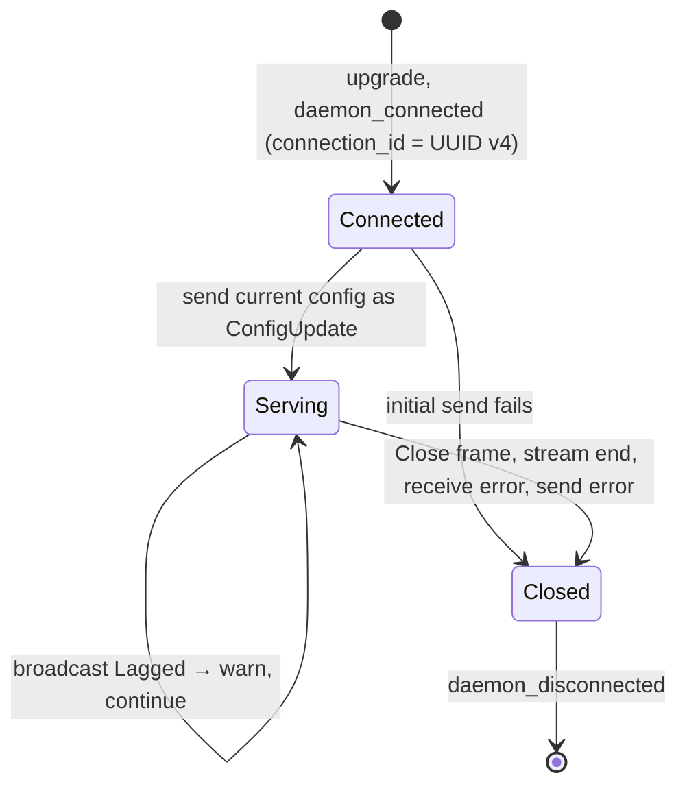

# L2 — Control plane

The control plane is a pure API service: it serves `/v1/*` (management API,
defined by `contract/openapi.yaml`) and `/control` (daemon WebSocket). It
serves no UI; dashboards, CLIs, and other clients are deployed separately (see
[ADR 0001](../adr/0001-api-only-stateless-control-plane.md)).

| Module | Responsibility |
| --- | --- |
| `control-plane/src/main.rs` | Startup, `AppState`, `now_ts()` |
| `control-plane/src/api.rs` | `create_app`: `/v1` router, handlers, validation, CORS, JSON errors, `contract_tests` |
| `control-plane/src/control.rs` | `/control` WebSocket handler and per-daemon connection loop |
| `control-plane/src/store.rs` | `MemoryStore`: desired config, daemon sessions, usage history |
| `control-plane/src/virtual_keys.rs` | Opt-in PostgreSQL model/key storage, policy snapshots, and management/control authentication |
| `control-plane/src/key_api.rs` | LiteLLM-style key-management request mapping and response shapes |

With virtual-key mode enabled, desired models and keys are stored in PostgreSQL,
not `MemoryStore`. Management routes require the administrator token (except
liveness), and control connections authenticate a bound daemon identity.
Presence and recent usage remain process-local. See
[deployment](../virtual-keys.md) and [virtual-key design](./virtual-keys.md).

## Startup

1. Initialize `tracing_subscriber`.
2. `ConfigProvider::load()` reads the shared TOML (see
   [configuration.md](./configuration.md)).
3. Parse `control_plane.bind_addr` and `control_plane.cors_allowed_origins`;
   invalid values abort startup with an error naming the key.
4. Create a `tokio::sync::broadcast` channel with capacity 32.
5. Build `AppState { store, broadcast, started_at }`, seeding the store with
   `default_config()` (`poc-v1`, models `deepseek-v4-pro` and
   `deepseek-v4-flash`).
6. Bind and serve `create_app(state, cors_allowed_origins)`.

## Routes

| Method | Path | Handler | Behavior |
| --- | --- | --- | --- |
| GET | `/v1/health` | `health` | Liveness: `{ status: "ok", version }`. Declared unauthenticated in the contract. |
| GET | `/v1/status` | `status` | Summary: `{ version, uptime_seconds, connected_daemons, config_version }`. |
| GET | `/v1/config` | `get_config` | Current desired `ModelConfigSet`. |
| PUT | `/v1/config` | `put_config` | Validates, stores, and broadcasts the full set; returns it. |
| GET | `/v1/daemons` | `list_daemons` | `DaemonList { items }`, ordered by `connection_id`. |
| GET | `/v1/daemons/{connection_id}` | `get_daemon` | One `Daemon`, or JSON 404. |
| GET | `/v1/usage/events` | `list_usage_events` | `UsageEventPage`, newest first (see below). |
| POST | `/key/generate` | Virtual-key management | LiteLLM-style creation; one-time `key`, `models`, `key_alias`, optional `duration`. |
| GET | `/key/list` | Virtual-key management | Page/size pagination; hashes or full metadata, excluding deleted keys. |
| GET | `/key/info` | Virtual-key management | Metadata lookup by `key` hash (preferred) or plaintext. |
| POST | `/key/delete` | Virtual-key management | Atomic permanent deletion from active use; accepts a `keys` array. |
| GET | `/control` | `control::ws_handler` | WebSocket upgrade; see [Daemon connection lifecycle](#daemon-connection-lifecycle). |
| any | unmatched path | `not_found` | JSON 404 `{ error }`. `/` and the old `/api/*` paths also land here. |
| other | matched path, wrong method | `method_not_allowed` | JSON 405 `{ error }`. |

Malformed JSON bodies and query strings are mapped to JSON 400 instead of
axum's plain-text rejections, so every error matches `ErrorResponse`.

### Config validation (`validate_config`)

Rejected with `400 { "error": … }` when:

- `version` is blank;
- `models` is empty;
- any model has a blank `model_name` or `api_base`.

Provider names and `parameters` are not validated by the control plane.

### Usage paging (`list_usage_events`)

| Query | Default | Rules |
| --- | --- | --- |
| `limit` | 50 | 1..=200, otherwise 400 |
| `cursor` | none | Opaque; pass back `next_cursor` from the previous page. Malformed → 400. |
| `daemon_id` | none | Exact match |
| `model_name` | none | Exact match |

Each stored event gets an internal, increasing sequence number. The cursor is
that number for the last item returned, and the next page returns only older
events. Filters apply before `limit`, so a page is never short just because
non-matching events were skipped. `next_cursor` is `null` when no older matching
event exists.

### CORS

When `cors_allowed_origins` is non-empty, a `tower-http` `CorsLayer` allows
those exact origins, methods `GET`/`PUT`/`POST`, and headers `Authorization` and
`Content-Type`. When it is empty (the default) no CORS headers are sent; the
web dev and preview servers proxy `/v1`, so the browser sees one origin.

### Authentication

The contract declares a global `bearerAuth` scheme (with `/v1/health` exempt)
and documents `401` responses, but the server does **not** enforce it yet.
Clients should already send `Authorization: Bearer …` where they can.

## State (`store.rs`)

```rust
pub struct MemoryStore {
    inner: RwLock<Inner>,                         // tokio RwLock
}

struct Inner {
    config: ModelConfigSet,                       // desired config
    daemons: BTreeMap<String, Daemon>,            // key: connection_id
    usage: VecDeque<(u64, UsageEvent)>,           // (sequence, event), newest last
    next_sequence: u64,
}
```

Handlers only use `MemoryStore`'s async methods (`config`, `set_config`,
`summary`, `daemon_connected`, `daemon_disconnected`, `daemons`, `daemon`,
`apply_daemon_message`, `usage_events`); none of them see the lock. This narrow
API is the seam where PostgreSQL will plug in. It is a concrete struct today; a
trait will be extracted when a second implementation exists.

- **Lock choice.** `tokio::sync::RwLock` lets many readers run concurrently
  while WebSocket handlers take short write locks. No lock is held across a
  network send.
- **`BTreeMap`** gives `/v1/daemons` a stable order without sorting.
- **Usage history** keeps the latest 200 events (`USAGE_HISTORY_LIMIT`); older
  entries are popped from the front.
- **Keyed by connection, not `daemon_id`.** A record exists from the moment the
  socket opens, before `Registration` arrives. Two daemons that share a
  `daemon_id` show up as two rows.

## Daemon connection lifecycle

`control::handle_socket` runs one task per daemon connection.



The task subscribes to the broadcast channel before reading the config it sends
first, so an update made during the handshake is not lost. It then runs a
`tokio::select!` over `socket.recv()` and `updates.recv()`.

### `MemoryStore::apply_daemon_message`

Sets `last_seen = now`, then:

| Message | Effect on `Daemon` | Other effects |
| --- | --- | --- |
| `Registration` | Sets `daemon_id`, `cluster_name`, `version`, `hostname`, `capabilities` | Logs registration |
| `Heartbeat` | Sets `active_requests`, `loaded_models` | — |
| `Telemetry` | `total_requests += 1`; adds prompt and completion tokens; `failed_requests += 1` if `!success` | Converts to `UsageEvent`, stamps `received_at`, appends to usage history |

Invalid JSON is logged and ignored. Messages for a connection whose record has
already been removed are dropped.

### Sending (`send_control_message`)

Serializes to a text frame. Errors are logged at the failure site and returned
as `Result<(), ()>`. The caller only needs to know whether to stop the
connection, so no error payload is carried.

## Tests

`api::contract_tests` build the real router with `create_app` and call it
in-process (`tower::ServiceExt::oneshot`) against a store seeded with one
daemon and usage events:

| Test | Checks |
| --- | --- |
| `every_contract_operation_is_routed` | Every operation in `openapi.yaml` reaches a real handler |
| `every_get_response_matches_its_contract_schema` | Each GET 200 body has every contract-required field, recursively through `$ref`s |
| `config_put_round_trips_and_is_reported_in_status` | A PUT is visible in `GET /v1/config` and `/v1/status` |
| `invalid_config_is_a_json_400` | Validation and malformed JSON both return `ErrorResponse` |
| `daemon_lookup_returns_the_record_or_a_json_404` | `GET /v1/daemons/{id}` |
| `usage_events_page_newest_first_with_filters` | Ordering, cursor, and filters |
| `invalid_usage_queries_are_json_400` | Bad `limit` and `cursor` |
| `unknown_paths_and_methods_are_json_errors` | `/`, `/index.html`, `/api/status`, unknown `/v1` → 404; wrong method → 405 |
| `cors_is_only_granted_to_configured_origins` | Allowed, denied, and disabled CORS |

`store::tests` cover bounded history, paging, filter-before-limit, null
serialization, and messages for unknown connections. The WebSocket path is not
covered by automated tests.

## Known gaps

The items below except the last are resolved by later steps of
[ADR 0001](../adr/0001-api-only-stateless-control-plane.md): `MemoryStore` is
replaced by PostgreSQL (`config_versions`, `daemon_sessions`, `usage_events`),
and `tokio::broadcast` is fed by `LISTEN config_changed` instead of
`put_config`.

- State is in memory only and lost on restart; running more than one instance
  gives each its own state.
- Bearer auth is declared in the contract but not enforced; `/control` is
  unauthenticated.
- No config history or rollback endpoint.
- A daemon that lags the broadcast channel by more than 32 messages misses the
  skipped updates until it reconnects. Because every update is a full snapshot,
  a fix is to re-send the current config on `Lagged`.
- Every telemetry event takes the store's write lock. At high request rates,
  telemetry should move to a separate lock or channel, or to an
  OpenTelemetry/OTLP pipeline.
- Stale daemons are only removed when the socket closes; `last_seen` is not
  used for timeouts.
- `ControlMessage::Command` has no sender.
