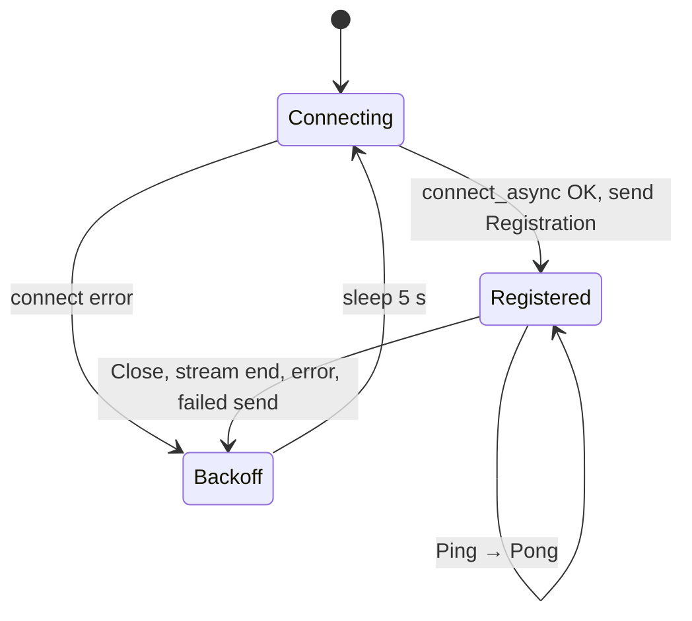
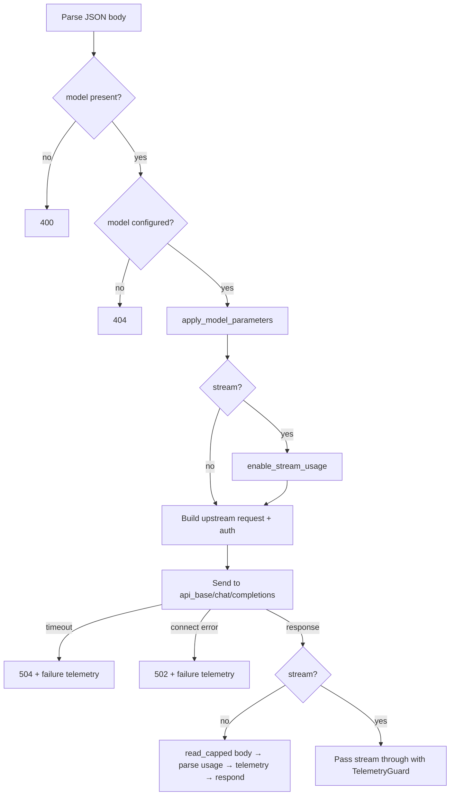

# L2 — Daemon

Source: `daemon/src/main.rs` (CLI, settings, control channel),
`daemon/src/api.rs` (HTTP routes and inference handler), and
`daemon/src/upstream.rs` (parameter mapping, usage extraction, streaming).

The daemon depends only on the `protocol` crate. It is built and shipped as a
single binary; see [`daemon/README.md`](../../daemon/README.md).

## Startup

```text
daemon [--config <path>] [--cp <ws-url>] [other overrides]
```

1. Parse CLI arguments (`clap`).
2. Load `DaemonConfig` from an explicit `--config` file or the daemon host's
   `./config.toml` when present. If neither exists, use built-in defaults.
   Unknown keys are rejected.
3. Resolve settings in precedence order: CLI option, environment variable,
   TOML value, then built-in default (see [configuration.md](./configuration.md)).
   The control-plane URL is required and can come from `--cp`,
   `CONTROL_PLANE_URL`, or the TOML `cp` setting.
4. Warn if `DAEMON_API_KEYS` is empty, because `/v1/*` is then unauthenticated.
5. Create the telemetry `mpsc` channel (capacity 256) and `AppState`.
6. Bind `listen_addr` **before** spawning the control channel, then log the
   bound address. With the default `127.0.0.1:0`, the API is local-only and
   this log line is the only place the OS-selected port appears.
7. Spawn `run_control_channel` and serve the HTTP router.

## State

```rust
struct AppState {
    settings: Arc<DaemonSettings>,
    models: Arc<RwLock<HashMap<String, ModelConfig>>>, // key: model_name
    models_updated_at: Arc<AtomicI64>,
    active_requests: Arc<AtomicU32>,
    dropped_telemetry: Arc<AtomicU64>,
    telemetry_tx: mpsc::Sender<DaemonMessage>,
    client: reqwest::Client,  // shared pool, connect and read timeouts
    started_at: i64,
}
```

Request handlers hold the model lock only long enough to clone one
`ModelConfig`. Counters are lock-free atomics.

## Control channel (`run_control_channel`)



- **`ConfigUpdate`** replaces the whole model table and updates
  `models_updated_at`. Models absent from the update disappear immediately.
- **`Command`** is logged only.
- The heartbeat interval uses `MissedTickBehavior::Delay`, so a slow socket does
  not cause a burst of heartbeats.
- Telemetry produced while disconnected waits in the `mpsc` buffer. Handlers use
  `try_send`, so a full buffer drops the event and increments
  `dropped_telemetry` instead of blocking a request.

## HTTP routes (`api.rs`)

| Method | Path | Auth | Response |
| --- | --- | --- | --- |
| GET | `/healthz` | none | `status`, `daemon_id`, uptime, model count, active requests, dropped telemetry |
| GET | `/v1/models` | API key | OpenAI list of configured models |
| GET | `/v1/models/:model_name` | API key | One model, or 404 |
| POST | `/v1/chat/completions` | API key | Upstream response passed through |

### Client authentication (`require_api_key`)

If `DAEMON_API_KEYS` (comma-separated) is set, `/v1/*` requires
`Authorization: Bearer <key>`. Keys are compared in constant time. A failure
returns 401 in OpenAI error shape. If the variable is unset, the API is open.

## Chat completion pipeline



### Parameter mapping (`apply_model_parameters`)

`ModelConfig.parameters` is a string map set by the operator.

| Key | Effect |
| --- | --- |
| `upstream_model` | Overwrites `model` in the body, so a public alias can map to a provider model id |
| `api_key`, `api_key_env` | Used for upstream auth only; never copied into the body |
| anything else | Inserted into the body **only if the client did not set it**. The value is parsed as JSON when possible (`"0.2"` → number), otherwise sent as a string |

Endpoint: `chat_completions_endpoint(api_base)` trims a trailing `/` and
appends `/chat/completions` unless it is already present.

### Upstream authentication precedence (`configured_api_key`)

1. `api_key_env`: read the named environment variable on the daemon host.
2. `api_key`: the literal value from the config.
3. Otherwise, forward the client's `Authorization` header unchanged.

### Non-streaming responses

- The total request is bounded by `request_timeout` (default 120 s).
- The body is buffered up to `max_response_bytes` (default 16 MiB). Exceeding
  it, or a read error, returns 502 and reports failure telemetry.
- On 2xx, `usage.prompt_tokens` and `usage.completion_tokens` are read from the
  body. Telemetry has `success = status.is_success()`.
- Upstream status, `Content-Type`, and `Cache-Control` are forwarded, plus
  `x-daemon-request-id`.

### Streaming responses

- No total timeout. Each read is bounded by `read_timeout` (default 60 s) on the
  shared client.
- For `provider = "custom_openai"`, `stream_options.include_usage = true` is
  injected so the provider sends a final usage chunk. The per-model parameter
  `include_usage = "false"` disables this.
- `streaming_body` wraps the upstream byte stream. Each chunk is forwarded
  unchanged and also fed to a `UsageScanner`, which parses SSE `data:` lines
  for a `usage` object. Its line buffer is capped at 256 KiB
  (`MAX_SSE_SCAN_BUFFER`).
- `TelemetryGuard` reports exactly once:

  | Outcome | `success` |
  | --- | --- |
  | Upstream stream ends normally | `true` |
  | Upstream stream errors | `false` |
  | Client disconnects (guard dropped) | `false`, with any usage seen so far |

- `ActiveRequestGuard` keeps the request counted in `active_requests` until the
  stream body finishes, not just until headers are sent.

### Errors

All daemon-generated errors use the OpenAI shape:

```json
{"error":{"message":"upstream provider timed out","type":"daemon_error","param":null,"code":504}}
```

Upstream error responses (4xx/5xx with a body) are passed through unchanged.

## Tests

`api.rs` tests run the real router against an in-process fake upstream. They
cover unary usage, streaming usage split across chunks, `stream_options`
injection, upstream failure, timeout (504), API key rejection, active-request
accounting during streaming, and health/model lookup. `main.rs`
`config_tests` cover the example config and the required CLI flags.

## Known gaps

- `api_key` values arrive over the control channel in plaintext; prefer
  `api_key_env`.
- `include_usage` is not in the parameter skip list, so when set it is also
  copied into the request body as a top-level field.
- No retries, fallbacks, or load balancing across several `api_base` values.
- Only `/v1/chat/completions` is proxied (no embeddings, completions, or
  responses APIs).
- `CLUSTER_NAME` defaults to `cluster-ssh198`; it should be set per deployment.
- Connection retries use a fixed 5 s delay with no jitter, so many daemons
  reconnect in lockstep after a control-plane restart.
