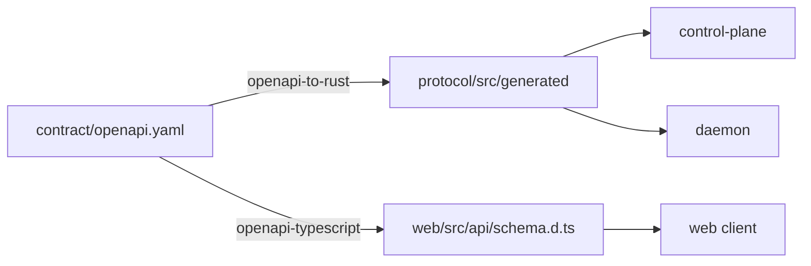

# L2 — Protocol and contract

There are two distinct protocols, kept in one crate (`protocol`) so both
services share the same types.

| Protocol | Peers | Source of truth | Rust types | TypeScript types |
| --- | --- | --- | --- | --- |
| Management API (HTTP/JSON, `/v1`) | Clients (web, CLI, …) ⇄ control plane | `contract/openapi.yaml` | Generated into `protocol/src/generated/` | Generated into `web/src/api/schema.d.ts` |
| Control channel (WebSocket/JSON) | Daemon ⇄ control plane | `protocol/src/lib.rs` | Hand-written | Not needed (clients never speak it) |

## Contract-first workflow



1. Edit `contract/openapi.yaml`.
2. Run `scripts/generate-types.sh` to regenerate both outputs.
3. CI (or a developer) runs `scripts/generate-types.sh --check` to fail on stale
   generated code.
4. `contract_tests` in `control-plane/src/api.rs` exercise the real router, so
   a route or response shape that drifts from the contract fails `cargo test`.

Generated files are never edited by hand. `protocol/src/generated` is marked
`#[rustfmt::skip]` so formatting does not make `--check` report it as stale.
`protocol/src/lib.rs` adds small conveniences (`new`, `insert`, `get`, `iter`,
`is_empty`) on top of the generated `ModelConfigParameters` map.

### Management API (v1)

Conventions: JSON only; errors are always `ErrorResponse { error }`; timestamps
are Unix seconds; collections are wrapped in an object (`{ items, … }`) so
fields can be added without breaking clients. A global `bearerAuth` scheme is
declared (with `/v1/health` exempt) but not yet enforced.

| Operation | Request | Response |
| --- | --- | --- |
| `GET /v1/health` | — | `HealthResponse { status, version }` |
| `GET /v1/status` | — | `StatusResponse { version, uptime_seconds, connected_daemons, config_version }` |
| `GET /v1/config` | — | `ModelConfigSet` |
| `PUT /v1/config` | `ModelConfigSet` | `ModelConfigSet` (or 400) |
| `GET /v1/daemons` | — | `DaemonList { items: Daemon[] }` |
| `GET /v1/daemons/{connection_id}` | — | `Daemon` (or 404) |
| `GET /v1/usage/events` | `limit`, `cursor`, `daemon_id`, `model_name` | `UsageEventPage { items: UsageEvent[], next_cursor }` |

| Schema | Notes |
| --- | --- |
| `ModelConfigSet` | `{ version, models[] }`; always the full desired set |
| `ModelConfig` | `model_name`, `provider`, `api_base`, `parameters` (string → string map) |
| `Daemon` | One connection: identity, `connected_at`, `last_seen`, counters, `loaded_models` |
| `UsageEvent` | One upstream call, stamped with `received_at` |
| `ErrorResponse` | All 4xx responses |

## Control-channel messages

Every frame is a JSON text frame with a `type` discriminator (`#[serde(tag = "type")]`).

### Control plane → daemon: `ControlMessage`

| `type` | Fields | Behavior |
| --- | --- | --- |
| `ConfigUpdate` | `version`, `models: ModelConfig[]` | Sent on connect and on every accepted `PUT /v1/config`. The daemon replaces its entire model table. |
| `Command` | `cmd`, `reason` | Reserved. Never sent by the control plane today; the daemon only logs it. |

```json
{"type":"ConfigUpdate","version":"poc-v1","models":[{"model_name":"deepseek-v4-flash","provider":"custom_openai","api_base":"https://api.deepseek.com/v1","parameters":{"api_key_env":"DEEPSEEK_API_KEY"}}]}
```

The `ConfigUpdate` payload is the contract's `ModelConfigSet`
(`impl From<ModelConfigSet> for ControlMessage`). The variant name is kept, so
the wire format did not change when the HTTP API moved to v1.

### Daemon → control plane: `DaemonMessage`

| `type` | Fields | When |
| --- | --- | --- |
| `Registration` | `daemon_id`, `cluster_name`, `version`, `capabilities[]`, `hostname` | Once, immediately after each connect |
| `Heartbeat` | `daemon_id`, `active_requests`, `loaded_models[]` | Every 5 s |
| `Telemetry` | `daemon_id`, `model_name`, `prompt_tokens`, `completion_tokens`, `success`, `request_id`, `latency_ms`, `status_code?`, `streamed`, `usage_reported` | After every upstream call completes or fails |

```json
{"type":"Telemetry","daemon_id":"daemon-poc-001","model_name":"deepseek-v4-flash","prompt_tokens":12,"completion_tokens":40,"success":true,"request_id":"6f1c…","latency_ms":812,"status_code":200,"streamed":true,"usage_reported":true}
```

`usage_reported: false` means the provider sent no `usage` object, so the token
counts are unknown, not zero.

`Telemetry` converts to the contract's `UsageEvent` with an exhaustive struct
literal (`impl From<Telemetry> for UsageEvent`). A field added on
either side therefore becomes a compile error instead of silent drift.
`received_at` is stamped by the control plane.

## Compatibility rules

- Messages that fail to deserialize are logged and ignored on both sides; they
  do not close the connection.
- There is no protocol version negotiation. Adding a required field is a
  breaking change, so daemons and the control plane must be upgraded together.

## Known gaps

- The control channel is not described by a machine-readable schema (for
  example AsyncAPI), so non-Rust clients have to read `protocol/src/lib.rs`.
- No message acknowledgements: the control plane cannot tell whether a daemon
  applied a `ConfigUpdate` except by watching `loaded_models` in heartbeats.
