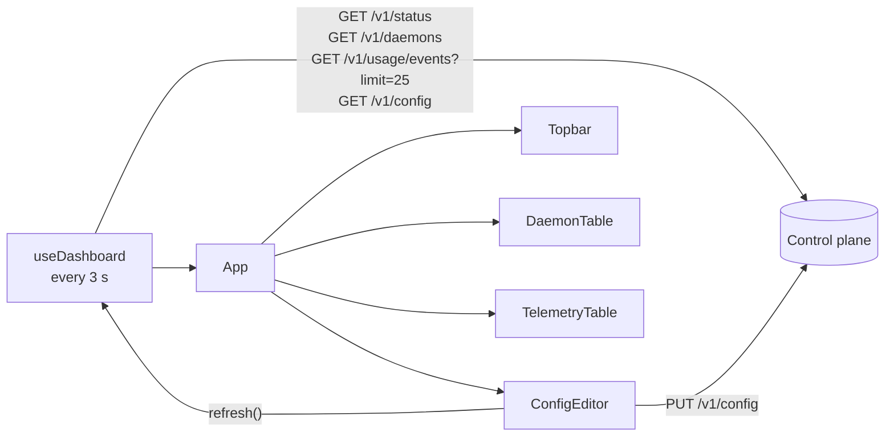

# L2 — Web dashboard

Source: `web/`. React 19 + TypeScript + Tailwind CSS 4, built with Vite and
tested with Vitest (jsdom).

The dashboard is one of several independent clients of the control plane's
`/v1` API (see [ADR 0001](../adr/0001-api-only-stateless-control-plane.md)).
The control plane does not serve it; the bundle runs locally (`vite dev` or
`vite preview`) or on any static host.

## Module structure

| Module | Responsibility |
| --- | --- |
| `src/api/schema.d.ts` | Generated from `contract/openapi.yaml` (`npm run generate:api`). Never edited. |
| `src/api/client.ts` | Contract type aliases and one typed function per operation: `getHealth`, `getStatus`, `getConfig`, `putConfig`, `listDaemons`, `getDaemon`, `listUsageEvents`. `ApiError` carries the HTTP status and the `ErrorResponse.error` message. |
| `src/api/useDashboard.ts` | Polling hook returning `{ snapshot, error, connection, refresh }` |
| `src/env.d.ts` | Types for `import.meta.env.VITE_CONTROL_PLANE_URL` |
| `src/App.tsx` | Page layout |
| `src/components/Topbar.tsx` | Server version, daemon count, config version, uptime, connection state, refresh |
| `src/components/DaemonTable.tsx` | One row per `Daemon` |
| `src/components/TelemetryTable.tsx` | Latest 25 `UsageEvent`s, newest first |
| `src/components/ConfigEditor.tsx` | JSON editor for `ModelConfigSet` |
| `src/components/Card.tsx`, `src/lib/format.ts` | Layout and formatting helpers |

## Base URL

`client.ts` prefixes every path with `VITE_CONTROL_PLANE_URL` (trailing slashes
trimmed), set at build time. When it is unset, requests go to the page's own
origin, which is what the dev and preview proxies expect. A bundle hosted on a
different origin sets it, and that origin must be listed in the control
plane's `cors_allowed_origins`.

## Data flow

In authenticated virtual-key deployments, operators apply an administrator
token through the password input in `App`. `client.ts` keeps it in memory and
adds an Authorization header to management calls; it is not stored in browser
storage or build-time configuration. Reloading requires applying the token
again. The form clears its input immediately after applying it.



### Polling (`useDashboard`)

- Every 3 s (configurable argument) it fetches the four resources in parallel
  and publishes them together as one `DashboardSnapshot`, so the panels never
  mix data from different polls. If any request fails, the whole poll fails.
- Each poll aborts the previous one with an `AbortController`, so a slow
  response cannot overwrite a newer one.
- Pauses while `document.hidden` and resumes on `visibilitychange`.
- `connection`: `connecting` before the first result, `live` after a success,
  `offline` after a failure. The last good snapshot stays on screen while
  offline.

### Config editing (`ConfigEditor`)

1. Shows the current `snapshot.config` as formatted JSON.
2. Once the user edits, the draft is marked dirty and polling no longer
   overwrites it.
3. "Push" parses the JSON and checks that it has a `version` string and a
   `models` array, then calls `putConfig`. Parse errors and server 400
   messages appear inline.
4. On success, the dirty flag is cleared and the snapshot is refreshed.

The editor is a raw JSON textarea; detailed validation is done by the control
plane.

## Build

```text
npm run build = generate:api → tsc --noEmit → vite build   (output: web/dist, git-ignored)
```

Because generation runs on every build, the TypeScript types cannot drift from
the contract unnoticed.

## Dev and preview servers (`vite.config.ts`)

- Read the shared `config.toml` (or `LLMCP_CONFIG`) with `smol-toml`.
- Both `npm run dev` and `npm run preview` listen on `web.addr` with
  `strictPort`, so they fail instead of picking another port.
- Both proxy `/v1` to the control plane. The HTTP origin is derived from
  `control_plane.websocket_url` (`ws:` → `http:`, `wss:` → `https:`, path
  dropped).

## Known gaps

- Authentication uses a manually applied administrator token; a full login
  flow and a dedicated virtual-key lifecycle UI are not implemented.
- Polling instead of push. A server-sent events or WebSocket feed would reduce
  latency and load with many dashboards open.
- No structured model editor or client-side schema validation.
- Usage view shows only the latest page; there is no paging UI, filtering, or
  charts, and the control plane keeps only 200 events.
